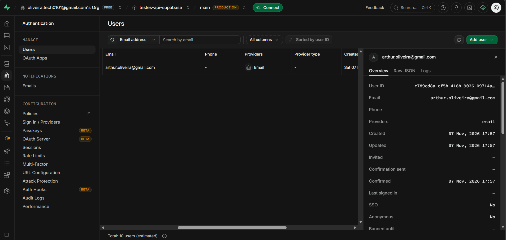
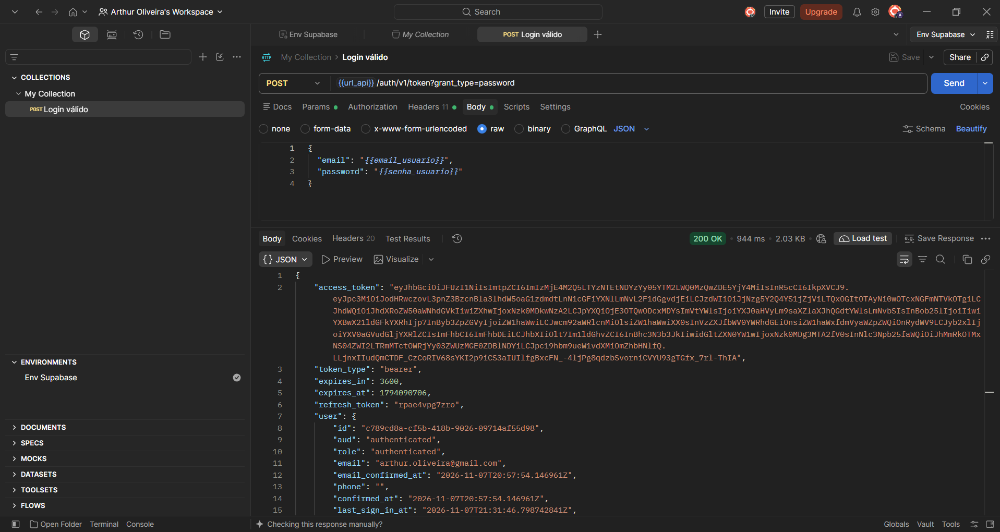
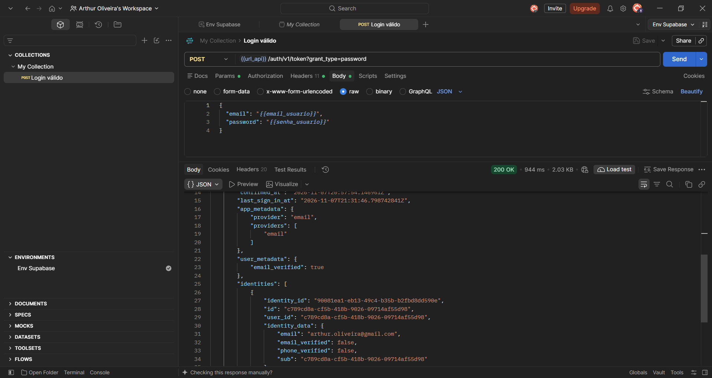
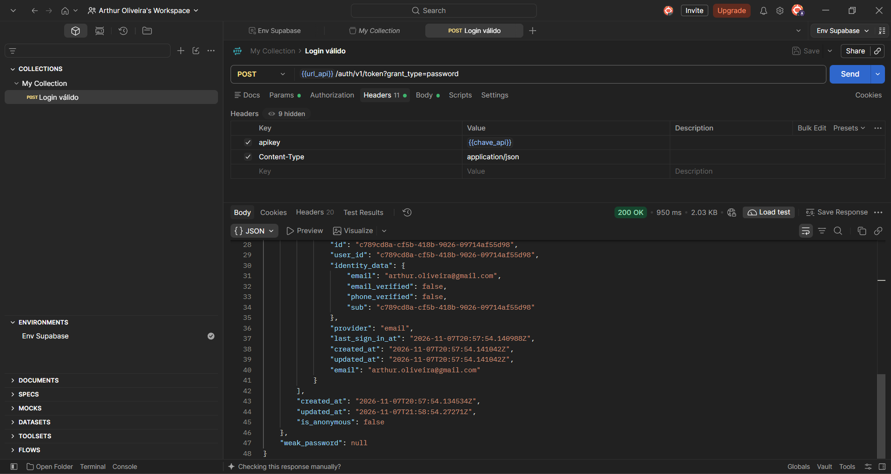
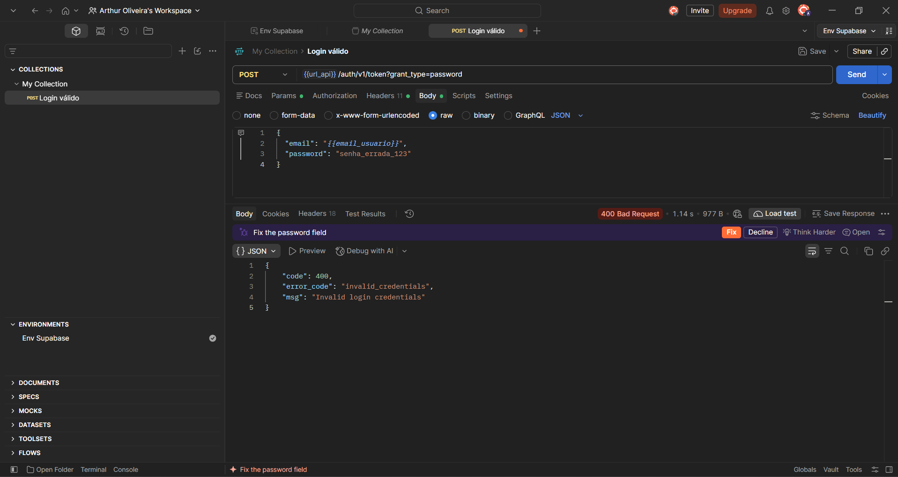
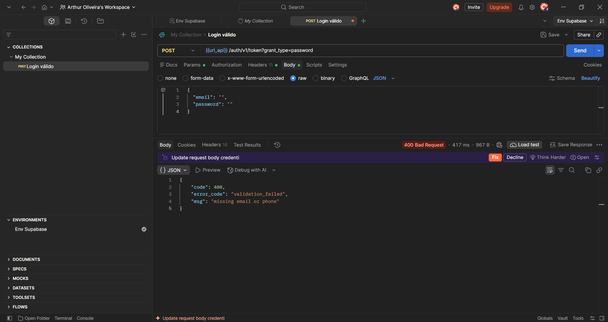

# Introdução

Este repositório foi criado para armazenar os resultados da atividade prática de Testes de Caixa Cinza. O ambiente escolhido para o teste foi a API de autenticação do Supabase, e as requisições foram simuladas utilizando o software Postman Desktop.

Aluno: Arthur Oliveira
RA: 250786

# Objetivo da Atividade

O propósito desta atividade foi aplicar conceitos de testes funcionais em uma API real. O foco principal foi compreender a estrutura de uma requisição HTTP (endpoint, headers e body) e validar como o sistema se comporta diante de dados corretos e incorretos no processo de login.

# Configuração do Supabase

Para a realização dos testes, foi criado um projeto no Supabase. A autenticação por e-mail foi habilitada e a confirmação de e-mail foi desativada para facilitar o fluxo. Um usuário de teste foi cadastrado manualmente no painel. As credenciais de acesso (URL do projeto e chave pública) foram extraídas para configurar o Postman.

*Evidências:* 

# Configuração do Postman

- **Workspace:** Foi configurado um Workspace exclusivo para a atividade de testes de API.
- **Environment:** Foi criado o ambiente `Env Supabase` contendo as variáveis: `url_api`, `chave_api`, `email_usuario` e `senha_usuario`. O uso dessas variáveis é uma boa prática, pois permite rodar os testes dinamicamente, sem a necessidade de digitar os dados de login manualmente a cada requisição.
- Os arquivos exportados da Collection e do Environment estão disponíveis na pasta `/postman` para consulta.

# Configuração das Requisições

A requisição foi montada utilizando o método HTTP POST no endpoint `/auth/v1/token?grant_type=password`. Os headers utilizados foram `apikey` (para autorizar a chamada) e `Content-Type: application/json`. O Body foi preenchido com um objeto JSON contendo as variáveis de e-mail e senha. O objetivo é receber um token de acesso válido.

*Evidências:*

# Execução dos Testes

Foram executados os cinco cenários de teste obrigatórios. As validações foram feitas observando o código de status HTTP, as mensagens de erro em JSON e a presença do token no caso de sucesso.

*Tabela de Cenários:*

| Cenário | Entrada Utilizada | Resultado Esperado | Resultado Obtido | Status |
| :--- | :--- | :--- | :--- | :--- |
| Login com dados válidos | E-mail e senha corretos | Status 200 + token | Status 200 + token | OK |
| Tentativa com senha errada | E-mail correto, senha inválida | Erro de autenticação | 400 - invalid_credentials | OK |
| Tentativa com usuário falso | E-mail não cadastrado | Acesso negado | 400 - invalid_credentials | OK |
| Envio de campos em branco | E-mail e senha vazios | Erro de validação | 400 - missing email or phone | OK |
| Formato de e-mail inválido | E-mail sem @, senha curta | Mensagem de erro | 400 - invalid_credentials | OK |

*Evidências:*

**Login com dados válidos:**

**Tentativa com senha errada:**

**Tentativa com usuário falso:**

**Envio de campos em branco:**

**Formato de e-mail inválido:**

# Registro dos Testes

Os resultados dos testes foram documentados numa tabela no Excel. Nela, constam os códigos de cada caso de teste (CT-01 a CT-05), os dados utilizados em cada tentativa, os retornos esperados e obtidos, e as notas do analista. Documentar é muito importante para que a equipe de desenvolvimento saiba como a API se comporta.

*Evidências:*

# Resultados Obtidos

Os cinco casos de teste planejados foram finalizados. A API do Supabase respondeu como o esperado: o JWT foi gerado no caso de sucesso, e os códigos HTTP 400 foram retornados para os casos de falha. Observou-se que a API utiliza uma mensagem genérica (`invalid_credentials`) para erros de senha e usuário falso, o que é uma boa prática de segurança. Para os campos em branco, a API retornou um erro específico de ausência de dados.

# Conclusão

A atividade foi finalizada com sucesso. A autenticação da API funcionou como esperado. A principal dificuldade foi entender como extrair as novas chaves de API do Supabase (as chaves Publishable). Não foram encontradas falhas de segurança nos cenários testados. Uma melhoria possível para o sistema seria a implementação de bloqueio temporário do usuário após múltiplas tentativas de login falhas (rate limit). Os testes de caixa cinza são essenciais para garantir que a autenticação e as regras de negócio estejam seguras.
